<div align="center">

# ⚡ Aletsch AI

### Auto-Instrumented Analytics for AI-Built Applications

**Connect your application. Let Aletsch AI understand how users interact with it.**

<br/>

[](https://nextjs.org/)
[](https://react.dev/)
[](https://www.typescriptlang.org/)
[](https://tailwindcss.com/)
[](https://clerk.com/)
[](https://www.mongodb.com/)

<br/>

[](#roadmap)
[](#)
[](#)
[](#license)

<br/>


</div>

---

# 🧠 What is Aletsch AI?

**Aletsch AI** is an AI-powered analytics platform designed for the new generation of applications built using **AI-assisted development and vibe-coding platforms**.

Tools such as **Lovable, Bolt, Replit, and AI coding assistants** can generate complete applications in minutes.

But there is a problem:

> **The application gets built. The analytics don't.**

Developers and founders often have little visibility into what users actually do inside their applications.

They may not know:

- Which pages users visit
- Which buttons users interact with
- Where users abandon onboarding
- Which forms fail to convert
- Which user journeys are most common
- Which interactions should be tracked
- Where the biggest conversion bottlenecks exist
- What actions could improve the product

Aletsch AI is being built to close that gap.

Instead of manually adding analytics events throughout a codebase, Aletsch AI aims to **understand the application itself**, determine what matters, automatically instrument meaningful interactions, and transform the resulting data into understandable product insights.

---

# 🎯 The Problem

Modern AI-assisted development has dramatically reduced the time required to build applications.

A developer can generate an application containing:

```text
Landing Page
      ↓
Sign Up
      ↓
Dashboard
      ↓
Create Project
      ↓
Connect Repository
      ↓
Run Analysis
```

But the generated application may contain little or no meaningful analytics instrumentation.

The developer may have no idea that the real user journey looks like:

```text
Landing Page
      ↓
Sign Up
      ↓
      ❌
      ↓
    EXIT
```

Traditional analytics platforms can solve this problem, but they often depend on developers manually defining and implementing tracking events.

This creates a gap between:

**building an application**

and

**understanding the application.**

---

# 💡 The Core Idea

Aletsch AI explores a different approach:

> **Instead of asking developers what they want to track, let the system understand what the application is trying to make users do.**

The long-term system is designed around:

```text
Application Code
       ↓
Code Understanding
       ↓
Semantic Intent Detection
       ↓
Automatic Instrumentation
       ↓
User Events
       ↓
Behavior Analysis
       ↓
Funnel Detection
       ↓
AI Insights
       ↓
Product Decisions
```

---

# 🚀 What Aletsch AI Does

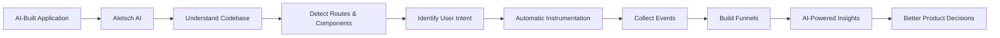

The long-term vision is:

### Traditional Workflow

```text
Build App
   ↓
Manually Add Analytics
   ↓
Configure Events
   ↓
Collect Data
   ↓
Analyze Data
   ↓
Figure Out What Happened
```

### Aletsch AI Workflow

```text
Build App
   ↓
Connect Repository
   ↓
Aletsch AI Understands It
   ↓
Automatic Instrumentation
   ↓
Automatic Event Collection
   ↓
Automatic Funnel Detection
   ↓
AI Explains What Happened
```

---

# 🖥️ Product Dashboard

Aletsch AI provides a centralized analytics workspace designed for developers and product builders.

The dashboard brings together:

- User analytics
- Application events
- Conversion funnels
- Instrumentation coverage
- AI-generated insights
- Drop-off analysis
- User journeys
- Alerts
- Reports
- Application health

The interface is intentionally designed around a **dark, developer-first analytics experience** with:

- Deep navy backgrounds
- Blue / purple accents
- Subtle gradients
- Glowing data visualizations
- Glass-like surfaces
- High information density
- Responsive layouts
- AI-focused interaction patterns

---

# 📊 Dashboard Overview

The dashboard is designed to answer one question:

> **"What is happening inside my application?"**

Example dashboard metrics:

```text
┌────────────────┬────────────────┬────────────────┬────────────────┐
│  Total Users   │ Events Tracked │  Conversion    │  Avg Session   │
│                │                │     Rate       │     Time       │
│     8,642      │     24.7K      │     34.6%      │     4m 32s     │
│    +12.5%      │    +18.3%      │     +6.1%      │     +8.7%      │
└────────────────┴────────────────┴────────────────┴────────────────┘
```

The dashboard also surfaces:

```text
Predicted User Funnel
Top Tracked Events
AI Insights
Instrumentation Status
Recent Activity
System Health
```

---

# 📊 Analytics Deliverables

Aletsch AI is designed to transform raw application behavior into **visual, interpretable product analytics**.

The following represent the types of analytics the platform is designed to generate.

> **Note:** Current visualizations may use representative/demo data. Real event ingestion, automated instrumentation, and AI-driven analysis are part of the upcoming development phases.

---

## 📈 User Activity Trend

Aletsch AI can surface changes in application activity over time, helping identify growth patterns, spikes, and unusual behavior.

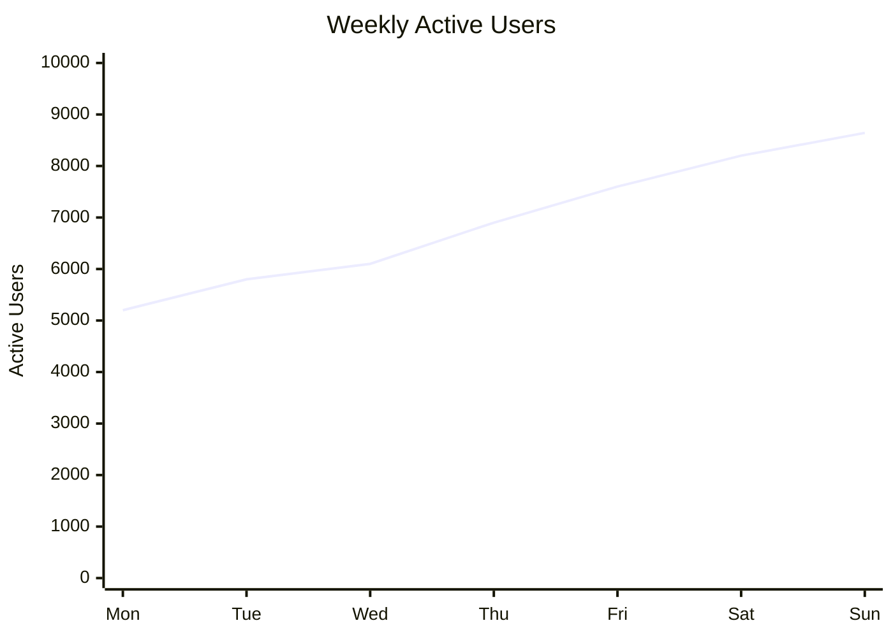

---

# 🎯 Conversion Funnel

One of the core outputs of Aletsch AI is an automatically generated user journey.

Example:

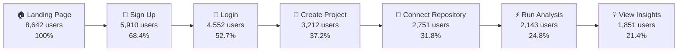

### Highest-Risk Drop-off

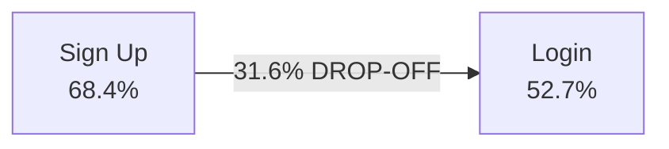

### Example AI Interpretation

> ⚠️ **31.6% of users leave between Sign Up and Login.**
>
> Aletsch AI can flag this transition as a high-friction stage and recommend investigating the authentication or onboarding flow.

---

# ⚡ Event Distribution

Aletsch AI can aggregate application interactions into meaningful event categories rather than exposing developers to thousands of unstructured clicks.

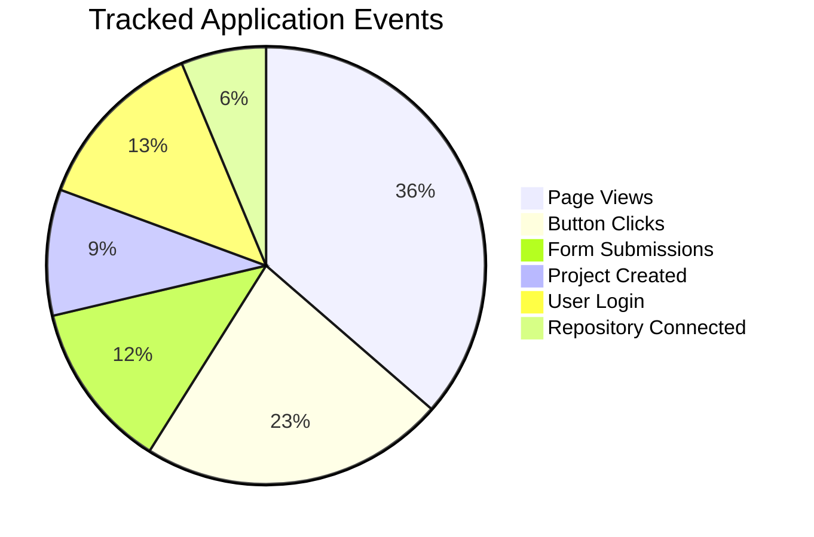

Example event categories:

```text
page_view
button_click
form_submit
sign_up
login
project_created
repository_connected
analysis_started
analysis_completed
insight_viewed
```

---

# 🧩 Instrumentation Coverage

Aletsch AI is designed to provide visibility into how much of an application has been successfully understood and instrumented.

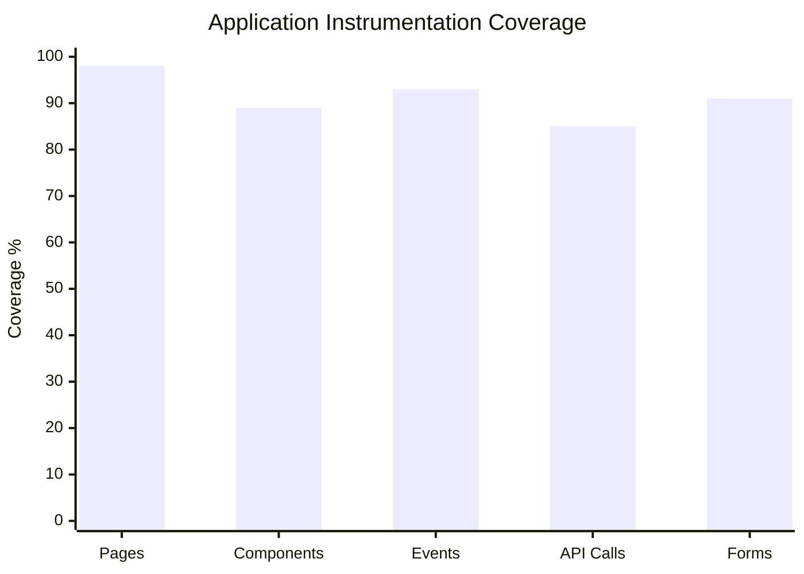

Example:

```text
Pages              ████████████████████ 98%
Components         ██████████████████░░ 89%
Events             ███████████████████░ 93%
API Calls          █████████████████░░░ 85%
Forms              ██████████████████░░ 91%
```

---

# 👥 User Journey Distribution

Aletsch AI can eventually identify the most common paths users take through an application.

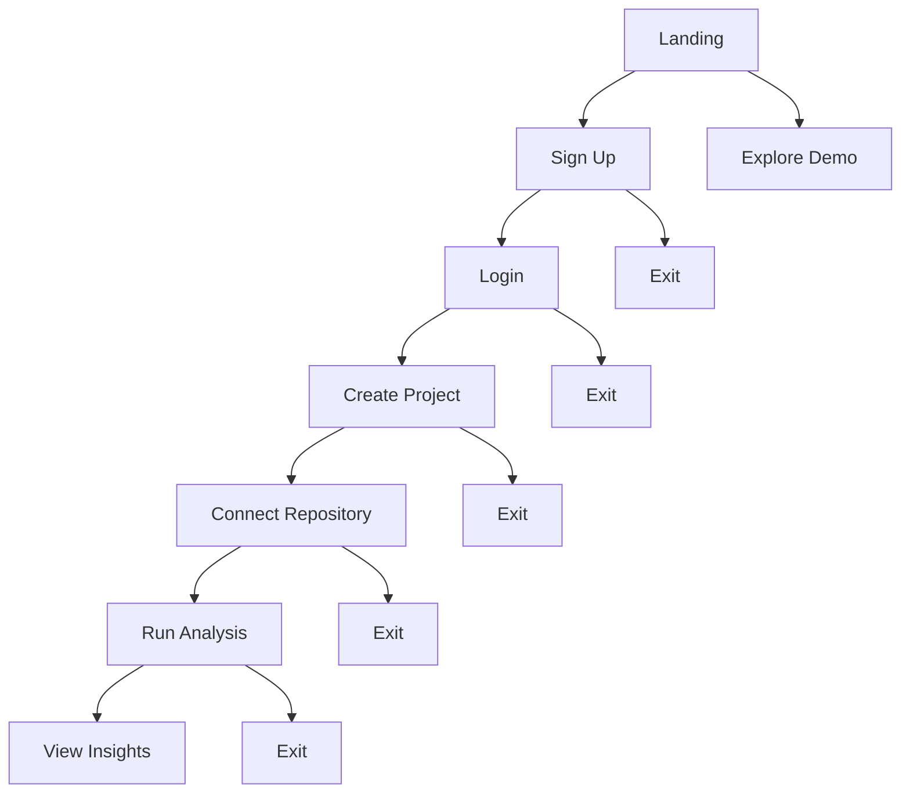

This allows the system to move beyond simple event counting and toward understanding **actual user journeys**.

---

# 🔥 Drop-off Risk Analysis

Aletsch AI can rank funnel stages according to potential user friction and business impact.

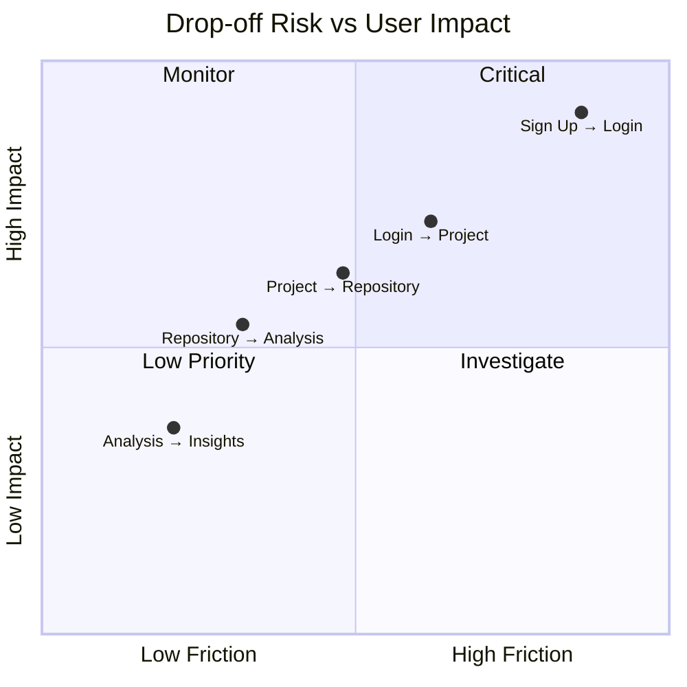

This allows the analytics engine to prioritize issues instead of simply reporting every metric equally.

---

# 🤖 AI Insight Classification

The analytics engine can organize detected issues into actionable categories.

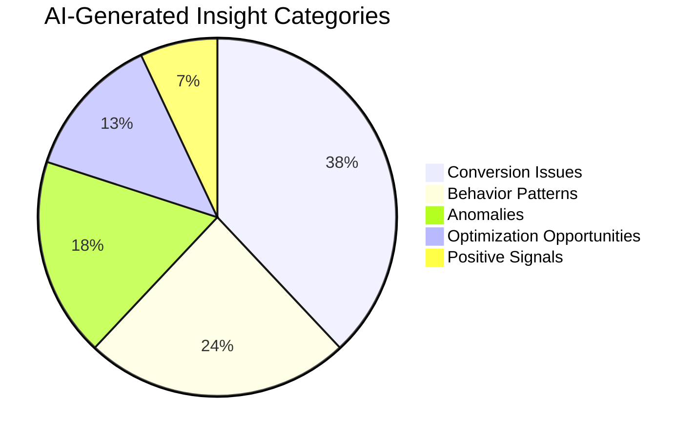

Example categories:

```text
🔴 Critical Conversion Issues
🟠 Behavioral Anomalies
🟡 Optimization Opportunities
🔵 Behavior Patterns
🟢 Positive Signals
```

---

# 🧠 From Raw Events to AI Insights

The important part of Aletsch AI is not simply collecting events.

The system is intended to transform events into **meaningful explanations**.

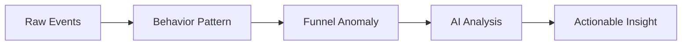

Example:

```text
24.7K Events
      ↓
High abandonment after Sign Up
      ↓
31.6% funnel drop-off
      ↓
AI identifies unusual friction
      ↓
"Authentication transition may be causing onboarding friction"
      ↓
Developer investigates the flow
```

---

# 🔬 Application Understanding

The system is designed to understand the semantic purpose of UI components.

For example:

```tsx
<Button onClick={handleCreateProject}>
    Create Project
</Button>
```

Instead of simply generating:

```text
button_clicked
```

Aletsch AI could eventually infer:

```text
Component:
CreateProjectButton

Intent:
Primary user action

Category:
Project Creation

Suggested Event:
project_created

Importance:
High

Funnel Stage:
Project Setup
```

This semantic layer is one of the key technical challenges of the project.

---

# 🧩 Auto-Instrumentation

The long-term system will analyze application source code and identify meaningful interactions.

The intended pipeline is:

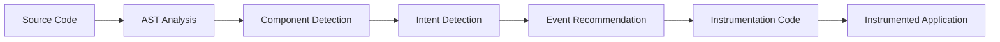

For example:

```text
ConnectRepositoryButton.tsx
              ↓
       Component detected
              ↓
      CTA intent detected
              ↓
   "Connect Repository"
              ↓
     Event generated
              ↓
repository_connected
```

---

# 🏗️ System Architecture

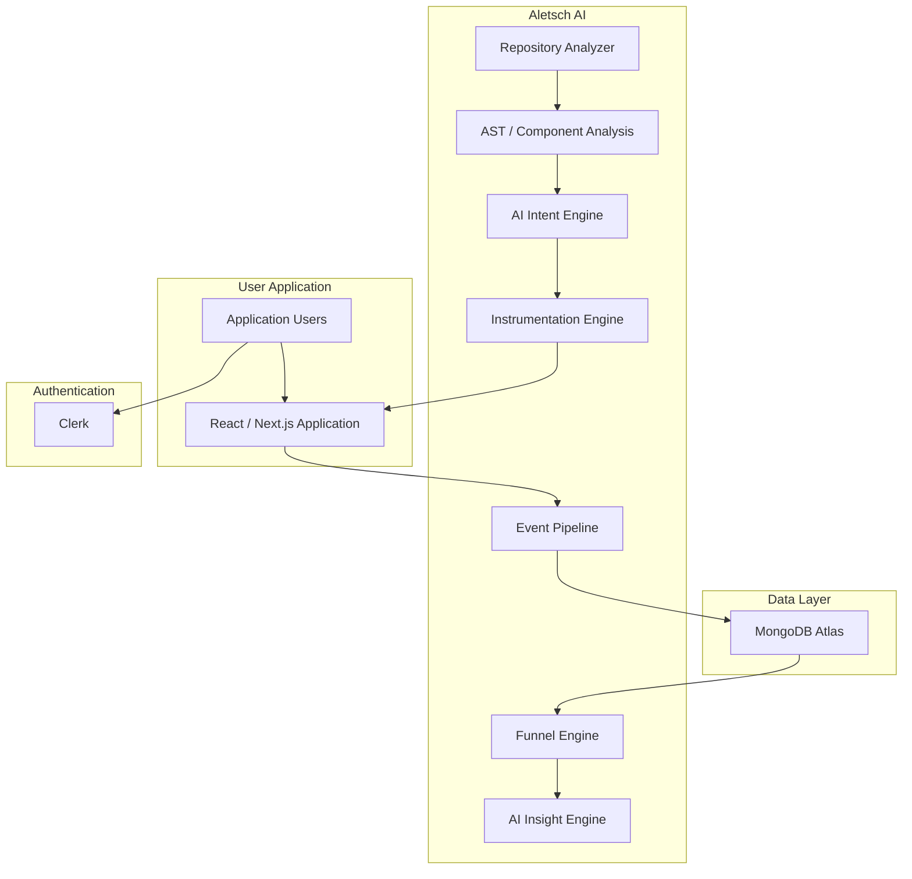

---

# 🔄 End-to-End Product Flow

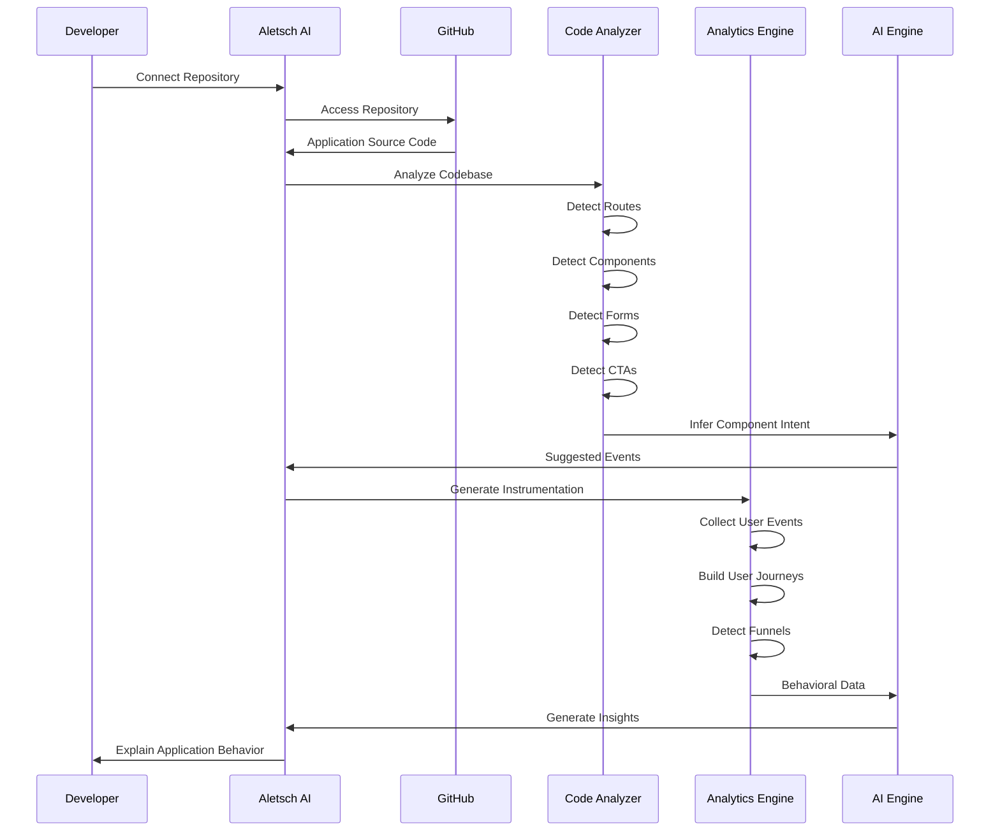

---

# 🔥 Analytics Intelligence Pipeline

The core analytical pipeline can be represented as:

```mermaid
flowchart TD

    A["Application Source Code"]
        ↓
    B["Structural Understanding"]
        ↓
    C["Semantic Understanding"]
        ↓
    D["Event Instrumentation"]
        ↓
    E["Behavior Collection"]
        ↓
    F["Journey Reconstruction"]
        ↓
    G["Funnel Analysis"]
        ↓
    H["Drop-off Detection"]
        ↓
    I["Pattern Recognition"]
        ↓
    J["AI Reasoning"]
        ↓
    K["Actionable Insight"]
```

---

# 📈 From Application Code to Product Decision

The complete vision is:

```text
┌───────────────────────────────┐
│       APPLICATION CODE        │
└───────────────┬───────────────┘
                ↓
┌───────────────────────────────┐
│      CODE UNDERSTANDING       │
└───────────────┬───────────────┘
                ↓
┌───────────────────────────────┐
│    SEMANTIC INTENT DETECTION  │
└───────────────┬───────────────┘
                ↓
┌───────────────────────────────┐
│     AUTO INSTRUMENTATION      │
└───────────────┬───────────────┘
                ↓
┌───────────────────────────────┐
│       USER BEHAVIOR           │
└───────────────┬───────────────┘
                ↓
┌───────────────────────────────┐
│      FUNNEL / JOURNEYS        │
└───────────────┬───────────────┘
                ↓
┌───────────────────────────────┐
│        AI ANALYSIS            │
└───────────────┬───────────────┘
                ↓
┌───────────────────────────────┐
│      PRODUCT INSIGHT          │
└───────────────┬───────────────┘
                ↓
┌───────────────────────────────┐
│       RECOMMENDED ACTION      │
└───────────────┬───────────────┘
                ↓
┌───────────────────────────────┐
│       BETTER APPLICATION      │
└───────────────────────────────┘
```

---

# 🌐 The Aletsch AI Analytics Loop

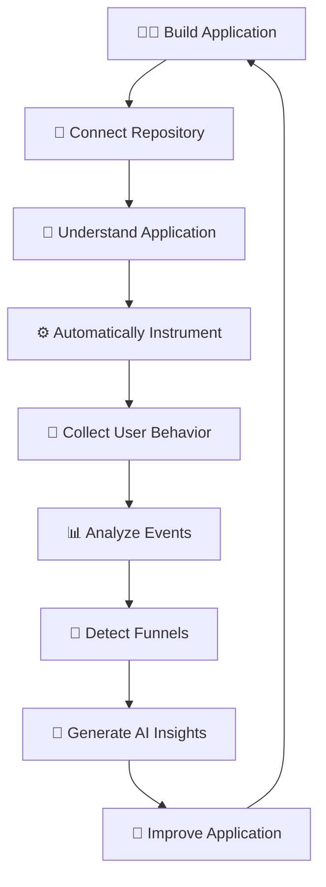

---

# 💎 What Aletsch AI Ultimately Produces

| Input | Aletsch AI Output |
|---|---|
| Application source code | Application structure |
| React components | Semantic interactions |
| Routes | User journeys |
| Forms | Conversion events |
| CTA buttons | Important actions |
| Raw events | Behavioral patterns |
| User journeys | Funnels |
| Funnel data | Drop-off points |
| Behavioral anomalies | AI insights |
| Insights | Recommended actions |

---

# 🧭 Product Modules

| Module | Purpose |
|---|---|
| 🏠 Dashboard | Application-wide analytics overview |
| 📁 Projects | Manage connected applications |
| 🔗 Repositories | Connect and manage source repositories |
| 🎯 Funnel Analysis | Analyze user journeys and conversion |
| ⚡ Events | Explore application events |
| 🧩 Instrumentation | Monitor analytics coverage |
| 🤖 AI Insights | Understand behavioral patterns |
| 📄 Reports | Generate analytics reports |
| 👥 Users | Explore user behavior |
| 🚨 Alerts | Surface important anomalies |
| ⚙️ Settings | Configure application preferences |

---

# 🛠️ Technology Stack

| Layer | Technology |
|---|---|
| Frontend | Next.js |
| Language | TypeScript |
| UI | React |
| Styling | Tailwind CSS |
| Components | shadcn/ui |
| Authentication | Clerk |
| Database | MongoDB Atlas |
| Future Code Analysis | TypeScript AST / Babel |
| Future Repository Integration | GitHub API |
| Future AI Layer | LLM-based Intent Analysis |
| Future Analytics Engine | Event & Funnel Processing |

---

# 📁 Project Structure

```text
aletsch_ai/
│
├── app/
│   ├── dashboard/
│   ├── projects/
│   ├── repositories/
│   ├── funnel-analysis/
│   ├── events/
│   ├── instrumentation/
│   ├── insights/
│   ├── reports/
│   ├── users/
│   ├── alerts/
│   └── settings/
│
├── components/
│   ├── dashboard/
│   ├── charts/
│   ├── navigation/
│   └── ui/
│
├── lib/
│   ├── mongodb.ts
│   ├── auth.ts
│   └── utils.ts
│
├── models/
│   ├── Project.ts
│   ├── Repository.ts
│   ├── Event.ts
│   ├── Funnel.ts
│   └── Insight.ts
│
├── public/
│
├── .env.example
├── package.json
├── tsconfig.json
└── README.md
```

---

# 🔐 Authentication & Data Ownership

Aletsch AI uses **Clerk** for authentication.

Projects and repositories are designed to be associated with the authenticated user.

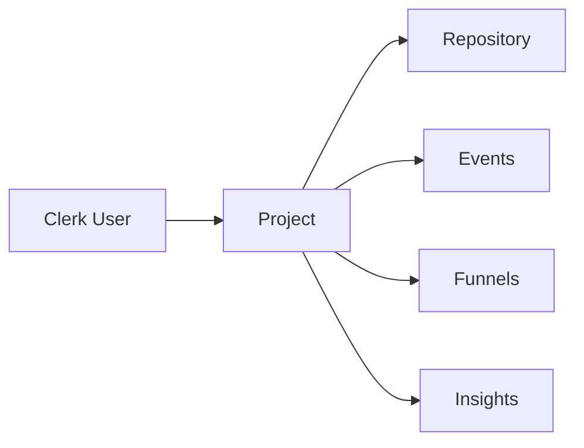

This architecture allows analytics data to be scoped to the appropriate user and project.

---

# 🗄️ Data Model

The initial database foundation is centered around several core entities.

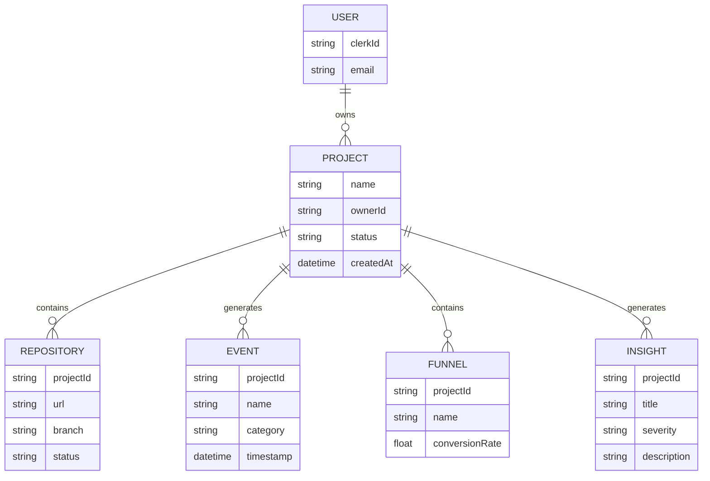

---

# 🗺️ Roadmap

Aletsch AI is being developed incrementally.

## Phase 1 — Foundation

- [x] Next.js application
- [x] TypeScript
- [x] Dashboard UI
- [x] Dark analytics interface
- [x] Responsive layout
- [x] Clerk authentication
- [x] MongoDB Atlas integration
- [x] Project architecture
- [x] Analytics dashboard
- [x] Representative analytics data

## Phase 2 — Repository Intelligence

- [ ] GitHub repository connection
- [ ] Repository metadata extraction
- [ ] Source code analysis
- [ ] Route detection
- [ ] Component detection
- [ ] Form detection
- [ ] CTA detection
- [ ] API interaction detection

## Phase 3 — Semantic Understanding

- [ ] Component intent inference
- [ ] User journey inference
- [ ] Event recommendation engine
- [ ] Event importance scoring
- [ ] Application archetype detection

## Phase 4 — Automatic Instrumentation

- [ ] Event generation
- [ ] Analytics SDK integration
- [ ] Automatic instrumentation
- [ ] Code modification pipeline
- [ ] Instrumentation validation
- [ ] Repository update workflow

## Phase 5 — Analytics Engine

- [ ] Real event collection
- [ ] Session tracking
- [ ] User journeys
- [ ] Funnel generation
- [ ] Drop-off detection
- [ ] Behavioral segmentation

## Phase 6 — AI Analytics

- [ ] AI-generated insights
- [ ] Root-cause analysis
- [ ] Anomaly detection
- [ ] Conversion recommendations
- [ ] Natural-language analytics
- [ ] Automated reports

## Phase 7 — Production Platform

- [ ] GitHub webhooks
- [ ] Background processing
- [ ] Scalable event ingestion
- [ ] Team collaboration
- [ ] Advanced alerts
- [ ] Exportable reports
- [ ] Production deployment

---

# 🎓 Academic / Research Direction

Aletsch AI explores the intersection of:

- Artificial Intelligence
- Software Engineering
- Program Analysis
- Static Code Analysis
- Human-Computer Interaction
- Product Analytics
- Event Instrumentation
- Natural Language Processing
- User Behavior Analysis
- Automated Developer Tooling

The central research direction is:

> **Can application source code be used as a semantic source of information for automatically identifying and instrumenting meaningful user interactions?**

This shifts analytics instrumentation from a **manual developer task** toward an **AI-assisted program understanding problem**.

---

# 🔬 Key Technical Challenge

The hardest part of the system is not simply collecting events.

It is determining:

```text
What does this piece of application code mean?
```

For example:

```tsx
<Button onClick={handleSubmit}>
    Continue
</Button>
```

A basic analytics system might see:

```text
button_clicked
```

Aletsch AI aims to eventually understand:

```text
Component:
OnboardingContinueButton

Semantic Intent:
Continue onboarding

User Journey:
Onboarding

Funnel Stage:
Step 2 → Step 3

Suggested Event:
onboarding_step_completed

Importance:
High
```

That semantic understanding is the core technical challenge and research opportunity of the project.

---

# 🖼️ Screenshots

## Dashboard

Add the actual dashboard screenshot here:

```markdown

```

## Funnel Analysis

```markdown

```

## AI Insights

```markdown

```

> Screenshots can be placed inside `public/screenshots/`.

---

# ⚡ Getting Started

## 1. Clone the repository

```bash
git clone https://github.com/valentino0405/aletsch_ai.git

cd aletsch_ai
```

## 2. Install dependencies

```bash
npm install
```

## 3. Configure environment variables

Create:

```bash
.env.local
```

Add:

```env
NEXT_PUBLIC_CLERK_PUBLISHABLE_KEY=
CLERK_SECRET_KEY=

MONGODB_URI=
MONGODB_DB=
```

## 4. Start the development server

```bash
npm run dev
```

Open:

```text
http://localhost:3000
```

---

# 🔒 Environment Variables

| Variable | Purpose |
|---|---|
| `NEXT_PUBLIC_CLERK_PUBLISHABLE_KEY` | Clerk client authentication |
| `CLERK_SECRET_KEY` | Clerk server authentication |
| `MONGODB_URI` | MongoDB Atlas connection |
| `MONGODB_DB` | MongoDB database name |

**Never commit `.env.local` or production secrets to Git.**

---

# 🧪 Current Development Status

> 🚧 **Aletsch AI is currently in active development.**

### Currently implemented

```text
✓ Next.js application
✓ TypeScript
✓ Responsive dashboard
✓ Analytics-oriented UI
✓ Clerk authentication
✓ MongoDB foundation
✓ Project architecture
✓ Dashboard modules
✓ Representative analytics visualizations
```

### Under development

```text
○ GitHub repository intelligence
○ AST-based application analysis
○ Semantic component understanding
○ Automatic event generation
○ Automatic instrumentation
○ Real event ingestion
○ Funnel engine
○ AI-powered analytics
```

---

# 🤝 Contributing

Contributions, ideas, issues and discussions are welcome.

If you find a bug or have an idea for improving Aletsch AI:

1. Open an issue
2. Describe the problem or proposal
3. Include relevant screenshots or logs
4. Submit a pull request where appropriate

---

# 📜 License

This project is licensed under the MIT License.

---

<div align="center">

# ⚡ Aletsch AI

### Understand your application.
### Understand your users.
### Build better products.

<br/>

**Built with ❤️, TypeScript, AI and way too much caffeine.**

<br/>


</div>