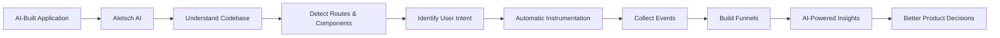
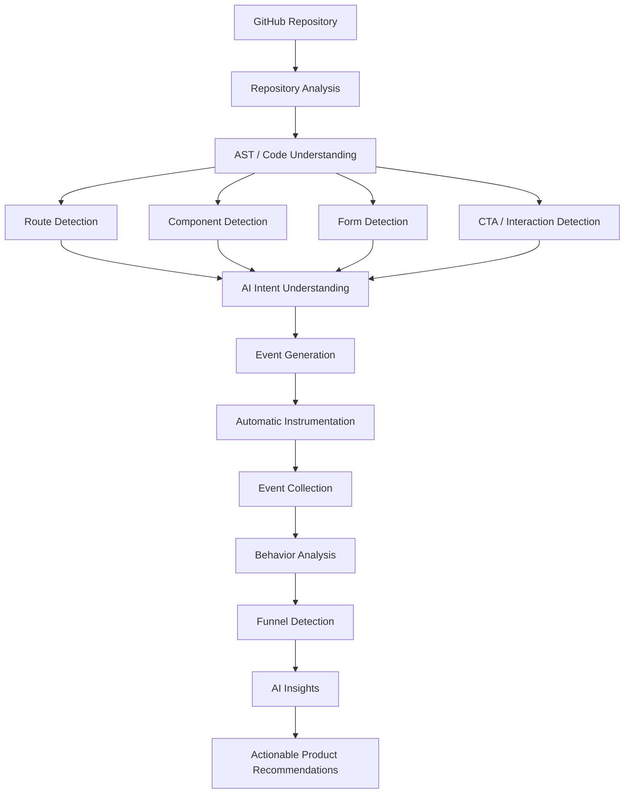
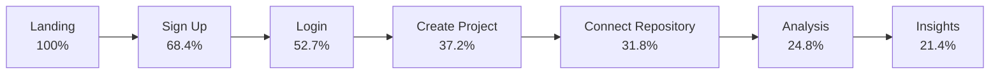
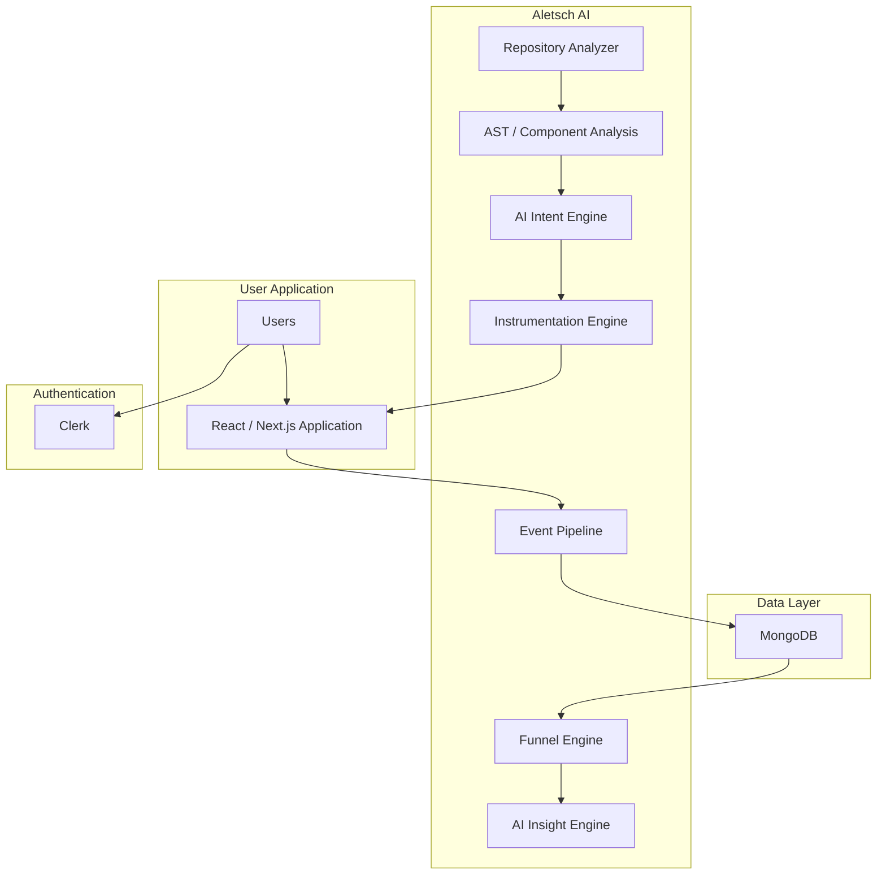
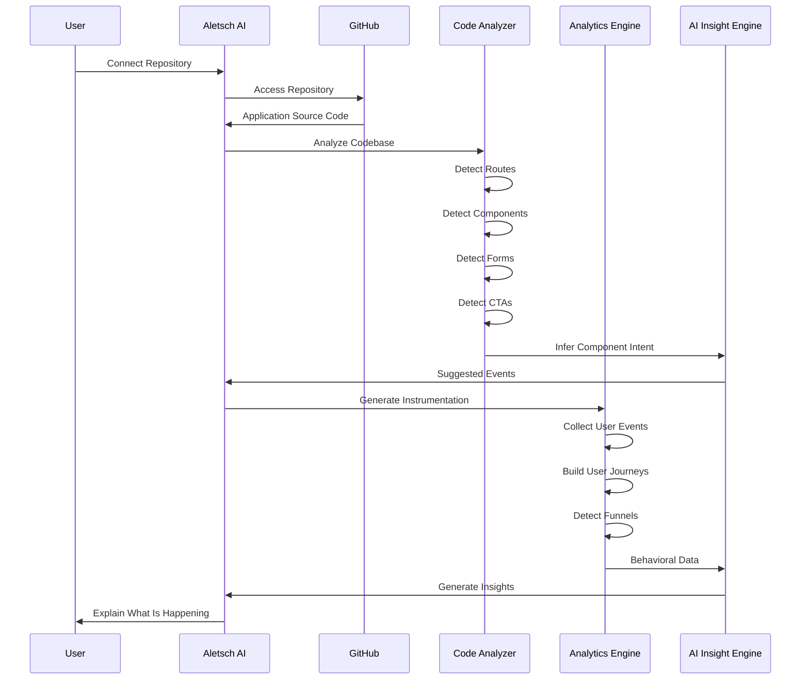
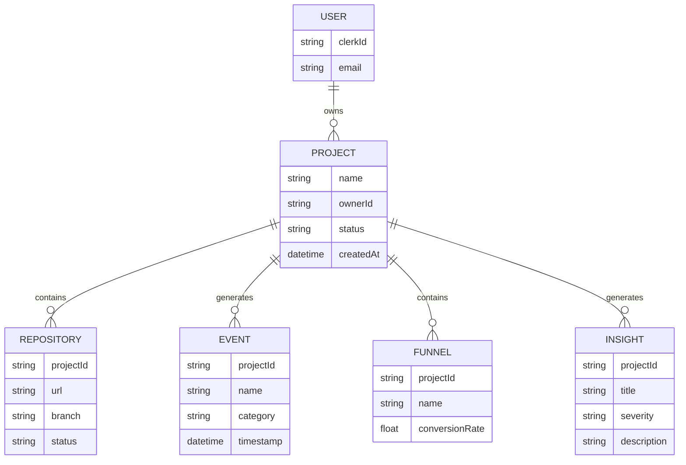

<div align="center">

# ⚡ Aletsch AI

### Auto-Instrumented Analytics for AI-Built Applications

**Connect your application. Let Aletsch AI understand how users interact with it.**

<br/>

[](https://nextjs.org/)
[](https://www.typescriptlang.org/)
[](https://react.dev/)
[](https://tailwindcss.com/)
[](https://clerk.com/)
[](https://www.mongodb.com/)

<br/>

[](#roadmap)
[](#)
[](#)
[](#license)

<br/>


</div>

---

## 🧠 What is Aletsch AI?

**Aletsch AI** is an AI-powered analytics platform designed for the new generation of applications built using **AI-assisted development and vibe-coding platforms**.

Tools such as **Lovable, Bolt, Replit and AI coding assistants** can generate complete applications in minutes.

But there is a problem:

> **The application gets built. The analytics don't.**

Developers and founders often have little visibility into what users actually do inside their applications.

They may not know:

- Which pages users visit
- Which buttons users interact with
- Where users abandon onboarding
- Which forms fail to convert
- Which user journeys are most common
- Which interactions should be tracked
- Where the biggest conversion bottlenecks exist
- What actions could improve the product

Aletsch AI is being built to close that gap.

Instead of manually adding analytics events throughout a codebase, Aletsch AI aims to **understand the application itself**, determine what matters, automatically instrument meaningful interactions, and transform the resulting data into understandable product insights.

---

# ✨ The Core Idea



The long-term vision is simple:

### From

```text
Build App
   ↓
Manually Add Analytics
   ↓
Collect Data
   ↓
Figure Out What Happened
```

### To

```text
Build App
   ↓
Connect Repository
   ↓
Aletsch AI Understands It
   ↓
Automatic Instrumentation
   ↓
Automatic Funnel Detection
   ↓
AI Explains What Happened
```

---

# 🚀 Why Aletsch AI?

Traditional product analytics platforms are extremely powerful, but meaningful instrumentation can still require developers to understand:

- Event tracking
- Analytics SDKs
- Tracking plans
- Custom events
- Funnels
- User properties
- Analytics implementation

Aletsch AI approaches the problem from a different direction.

Instead of asking:

> **"What events did the developer manually choose to track?"**

Aletsch AI aims to ask:

> **"What is this application trying to make the user do?"**

That distinction is the foundation of the project.

---

# 🎯 Problem Statement

Modern AI-assisted development has dramatically reduced the time required to build applications.

However, generated applications frequently lack proper observability and product analytics.

A developer can generate:

```text
Landing Page
      ↓
Sign Up
      ↓
Dashboard
      ↓
Create Project
      ↓
Connect Repository
      ↓
Run Analysis
```

but may have no idea that users are actually doing:

```text
Landing Page
      ↓
Sign Up
      ↓
     ❌
     ↓
   EXIT
```

The analytics gap becomes particularly important for non-technical founders and developers who are capable of building applications but may not have the time or expertise to manually instrument every interaction.

---

# 💡 Proposed Solution

Aletsch AI is designed around an automated analytics pipeline:



---

# 🖥️ Product Dashboard

The Aletsch AI dashboard is designed as a **developer-first analytics workspace**.

The interface provides a centralized view of:

- Application health
- User activity
- Funnels
- Events
- Instrumentation coverage
- AI-generated insights
- Drop-off points
- Alerts
- Reports

### Dashboard Concept

```text
┌───────────────────────────────────────────────────────────────┐
│ Aletsch AI                              Search    User        │
├───────────────┬───────────────────────────────────────────────┤
│               │                                               │
│ Dashboard     │  Total Users   Events   Conversion   Dropoff │
│ Projects      │  ──────────────────────────────────────────  │
│ Repositories  │                                               │
│ Funnels       │  Predicted User Funnel                       │
│ Events        │                                               │
│ Instrument.   │  Landing → Signup → Login → Analysis → Done │
│ AI Insights   │                                               │
│ Reports       │  ──────────────────────────────────────────  │
│ Users         │                                               │
│ Alerts        │  Top Events       AI Insights                │
│ Settings      │  Recent Activity  System Health              │
│               │                                               │
└───────────────┴───────────────────────────────────────────────┘
```

The visual language focuses on:

- Dark developer-oriented UI
- Neon blue / purple accents
- Subtle gradients
- Glass-like surfaces
- Data visualization
- AI-focused interaction patterns
- High information density
- Responsive layouts

---

# 📊 Core Dashboard Modules

## 👥 User Analytics

Understand how users interact with the application.

Example metrics:

```text
Total Users
8,642

Events Tracked
24.7K

Conversion Rate
34.6%

Average Session Time
4m 32s
```

---

## 🧭 Funnel Analysis

Aletsch AI is designed to automatically identify important user journeys.

Example:



The system can then highlight:

> ⚠️ **Highest Drop-off:** Sign Up → Login

and provide an AI-generated explanation.

---

# 🤖 AI Insights

Instead of presenting users with a wall of numbers, Aletsch AI aims to turn analytics into understandable explanations.

### Example

**High Drop-off Detected**

> 31.6% of users abandon the onboarding flow between Sign Up and Login.

### Possible Recommendation

> Simplifying the authentication transition and reducing the number of onboarding steps may improve conversion.

---

# 🔬 Auto-Instrumentation

This is the core technical capability of Aletsch AI.

The long-term system will analyze application source code and identify meaningful interactions.

For example:

```tsx
<Button onClick={handleCreateProject}>
    Create Project
</Button>
```

Aletsch AI should eventually understand:

```text
Component:
CreateProjectButton

Intent:
Primary user action

Category:
CTA

Suggested Event:
project_created

Importance:
High
```

The developer should not need to manually define every analytics event.

---

# 🧩 Application Understanding

Aletsch AI is designed to understand more than just raw clicks.

For example:

```text
<Button>
   Connect Repository
</Button>
```

is not merely:

```text
button_clicked
```

The system should eventually understand the semantic intent:

```text
Action:
Connect Repository

Business Meaning:
Repository onboarding

Journey:
Project Setup

Importance:
High
```

This semantic layer is what differentiates the project from basic click tracking.

---

# 🏗️ System Architecture



---

# 🔄 End-to-End Product Flow



---

# 🛠️ Tech Stack

| Layer | Technology |
|---|---|
| Frontend | Next.js |
| Language | TypeScript |
| UI | React |
| Styling | Tailwind CSS |
| Components | shadcn/ui |
| Authentication | Clerk |
| Database | MongoDB Atlas |
| Future Code Analysis | AST / TypeScript Parser |
| Future AI Layer | LLM-based Intent Analysis |
| Future Repository Integration | GitHub API |
| Deployment | Next.js-compatible hosting |

---

# 📁 Project Structure

```text
aletsch_ai/
│
├── app/
│   ├── dashboard/
│   ├── projects/
│   ├── repositories/
│   ├── funnel-analysis/
│   ├── events/
│   ├── instrumentation/
│   ├── insights/
│   ├── reports/
│   ├── users/
│   ├── alerts/
│   └── settings/
│
├── components/
│   ├── dashboard/
│   ├── charts/
│   ├── navigation/
│   └── ui/
│
├── lib/
│   ├── mongodb.ts
│   ├── auth.ts
│   └── utils.ts
│
├── models/
│   ├── Project.ts
│   ├── Repository.ts
│   ├── Event.ts
│   ├── Funnel.ts
│   └── Insight.ts
│
├── public/
│
├── .env.example
├── package.json
├── tsconfig.json
└── README.md
```

---

# 🔐 Authentication & Data Ownership

Aletsch AI uses **Clerk** for authentication.

Every project and repository will eventually be associated with the authenticated user.

Conceptually:

```text
Clerk User
     │
     ▼
  Project
     │
     ├── Repository
     │
     ├── Events
     │
     ├── Funnels
     │
     └── Insights
```

This ensures analytics data can be scoped to the correct project and user.

---

# 🗄️ Data Model

The initial database foundation is designed around several core entities.



---

# 🗺️ Roadmap

Aletsch AI is being developed incrementally.

### Phase 1 — Foundation

- [x] Next.js application
- [x] TypeScript
- [x] Dashboard UI
- [x] Dark analytics interface
- [x] Responsive layout
- [x] Clerk authentication
- [x] MongoDB Atlas integration
- [x] Project structure
- [x] Analytics dashboard mock data

### Phase 2 — Repository Intelligence

- [ ] GitHub repository connection
- [ ] Repository metadata extraction
- [ ] Source code analysis
- [ ] Route detection
- [ ] Component detection
- [ ] Form detection
- [ ] CTA detection
- [ ] API interaction detection

### Phase 3 — Semantic Understanding

- [ ] Component intent inference
- [ ] User journey inference
- [ ] Event recommendation engine
- [ ] Event importance scoring
- [ ] Application archetype detection

### Phase 4 — Automatic Instrumentation

- [ ] Event generation
- [ ] Analytics SDK integration
- [ ] Automatic instrumentation
- [ ] Code modification pipeline
- [ ] Instrumentation validation
- [ ] Repository update workflow

### Phase 5 — Analytics Engine

- [ ] Real event collection
- [ ] Session tracking
- [ ] User journeys
- [ ] Funnel generation
- [ ] Drop-off detection
- [ ] Behavioral segmentation

### Phase 6 — AI Analytics

- [ ] AI-generated insights
- [ ] Root-cause analysis
- [ ] Anomaly detection
- [ ] Conversion recommendations
- [ ] Natural-language analytics
- [ ] Automated reports

### Phase 7 — Production Platform

- [ ] GitHub webhooks
- [ ] Background processing
- [ ] Scalable event ingestion
- [ ] Team collaboration
- [ ] Alerts
- [ ] Exportable reports
- [ ] Production deployment

---

# 📈 The Vision

Aletsch AI is ultimately intended to create a loop like this:

```text
              ┌───────────────────┐
              │   Build Product   │
              └─────────┬─────────┘
                        ↓
              ┌───────────────────┐
              │ Connect Repository│
              └─────────┬─────────┘
                        ↓
              ┌───────────────────┐
              │ Understand Code   │
              └─────────┬─────────┘
                        ↓
              ┌───────────────────┐
              │ Track Behaviour   │
              └─────────┬─────────┘
                        ↓
              ┌───────────────────┐
              │ Understand Users  │
              └─────────┬─────────┘
                        ↓
              ┌───────────────────┐
              │ Generate Insights │
              └─────────┬─────────┘
                        ↓
              ┌───────────────────┐
              │ Improve Product   │
              └─────────┬─────────┘
                        │
                        └───────────────┐
                                        ↓
                                Build / Iterate Again
```

---

# 🌌 What Makes It Different?

Traditional analytics:

```text
Developer
   ↓
Manually defines events
   ↓
Adds SDK calls
   ↓
Collects data
   ↓
Analyzes dashboards
```

Aletsch AI:

```text
Developer
   ↓
Connects repository
   ↓
Aletsch AI understands application
   ↓
Identifies meaningful interactions
   ↓
Automatically instruments them
   ↓
Builds behavioral funnels
   ↓
Explains the data using AI
```

The key research and engineering challenge is therefore not simply **collecting analytics**.

It is:

> **Understanding application code well enough to automatically determine what user behavior is meaningful.**

---

# 🎓 Academic / Research Direction

Aletsch AI explores the intersection of:

- Artificial Intelligence
- Software Engineering
- Program Analysis
- Static Code Analysis
- Human-Computer Interaction
- Product Analytics
- Event Instrumentation
- Natural Language Processing
- User Behavior Analysis
- Automated Developer Tooling

The project specifically investigates how **application source code can be used as a source of semantic information for automated analytics instrumentation.**

---

# ⚡ Getting Started

## 1. Clone the repository

```bash
git clone https://github.com/valentino0405/aletsch_ai.git

cd aletsch_ai
```

## 2. Install dependencies

```bash
npm install
```

## 3. Configure environment variables

Create:

```bash
.env.local
```

Add:

```env
NEXT_PUBLIC_CLERK_PUBLISHABLE_KEY=
CLERK_SECRET_KEY=

MONGODB_URI=
MONGODB_DB=
```

## 4. Start the development server

```bash
npm run dev
```

Then open:

```text
http://localhost:3000
```

---

# 🔒 Environment Variables

| Variable | Purpose |
|---|---|
| `NEXT_PUBLIC_CLERK_PUBLISHABLE_KEY` | Clerk client authentication |
| `CLERK_SECRET_KEY` | Clerk server authentication |
| `MONGODB_URI` | MongoDB Atlas connection |
| `MONGODB_DB` | MongoDB database name |

**Never commit `.env.local` or production secrets to Git.**

---

# 🧪 Current Development Status

> **Aletsch AI is currently in active development.**

The current implementation focuses on:

```text
✓ Product UI
✓ Dashboard
✓ Authentication
✓ Database foundation
✓ Project architecture
✓ Analytics visualizations
✓ Mock analytics data
```

The intelligent repository-analysis and automatic-instrumentation pipeline is being developed incrementally.

---

# 🖼️ Screenshots

### Dashboard

Add your actual dashboard screenshot here:

```markdown

```

### Funnel Analysis

```markdown

```

### AI Insights

```markdown

```

> Tip: Keep screenshots inside `public/screenshots/` so the README can display them directly from the repository.

---

# 🧑‍💻 Development Philosophy

Aletsch AI follows a simple principle:

> **Don't make developers instrument everything. Make the system understand what matters.**

The platform is being built incrementally, with the analytics intelligence separated from the presentation layer.

This allows the project to evolve from a polished analytics dashboard into a complete automated instrumentation platform.

---

# 🤝 Contributing

Contributions, ideas, issues and discussions are welcome.

If you find a bug or have an idea for improving Aletsch AI:

1. Open an issue
2. Describe the problem or proposal
3. Include relevant screenshots/logs where possible
4. Submit a pull request for implementation

---

# 📜 License

This project is licensed under the MIT License.

---

<div align="center">

## ⚡ Aletsch AI

**Understand your application.  
Understand your users.  
Build better products.**

<br/>

Built with ❤️, TypeScript, AI and way too much caffeine.

<br/>


</div>